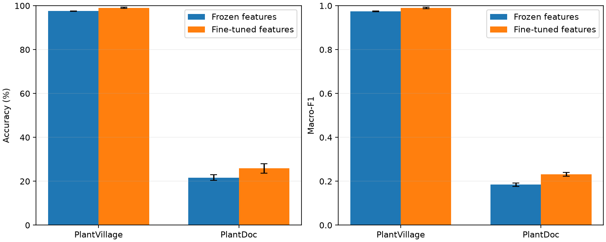
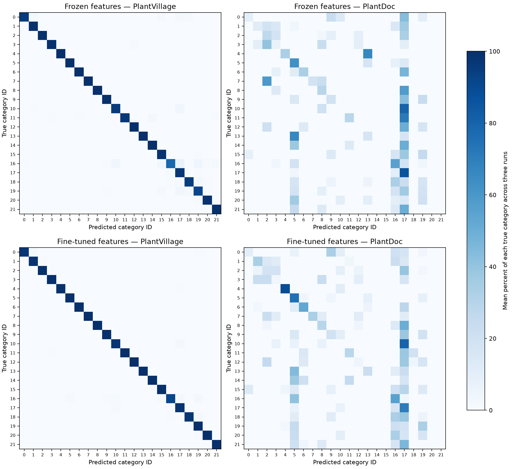

# Final test results: PlantVillage and PlantDoc

All six models selected using source validation have now been evaluated on the
reserved test images. The model files, image preparation, category mapping,
and test lists were fixed before these predictions. No model was retrained,
adapted to PlantDoc, or chosen because of a test score.

## Overall results

| Model | Test dataset | Distinct images | Mean accuracy ± sample SD | Mean macro-F1 ± sample SD |
| --- | --- | ---: | ---: | ---: |
| Frozen features | PlantVillage | 5,487 | 97.59% ± 0.10 pp | 0.9746 ± 0.0014 |
| Frozen features | PlantDoc | 183 | 21.68% ± 1.26 pp | 0.1848 ± 0.0080 |
| Fine-tuned features | PlantVillage | 5,487 | 99.07% ± 0.24 pp | 0.9899 ± 0.0028 |
| Fine-tuned features | PlantDoc | 183 | 25.87% ± 2.21 pp | 0.2319 ± 0.0092 |

The fine-tuned models averaged 99.07% on PlantVillage and 25.87% on PlantDoc. The large gap shows that strong same-dataset performance did not carry over to this external subset. These models have not demonstrated reliable classification across the two datasets.

Accuracy is the fraction classified correctly. Macro-F1 combines precision and
recall while giving each of the 22 categories equal weight. The ± values are
the sample standard deviation across the three training seeds. They are not
confidence intervals or uncertainty from drawing different test photographs.
“pp” means percentage points. All three runs reuse the same test images.

The error bars show variation across seeds. These results describe the selected
22-category subsets, not the entire original datasets or all casual-user photos.

## Difference between datasets

Each gap is PlantVillage accuracy minus PlantDoc accuracy for the same model
and seed, then averaged across the three seeds. Positive means lower accuracy
on PlantDoc; negative would mean higher accuracy on PlantDoc.

| Model | Mean source-minus-target accuracy gap ± sample SD |
| --- | ---: |
| Frozen features | 75.92 ± 1.30 percentage points |
| Fine-tuned features | 73.21 ± 2.30 percentage points |

This comparison measures a difference between datasets. It does not isolate
photography skill, weather, background, disease severity, label quality, or
class proportions as causes. Those factors may differ together. No causal
claim about weather or photographer ability follows from these scores.

PlantDoc has only 183 eligible test images, with 3–12 per category. A few errors
can strongly affect category scores. The three runs do not provide three
independent test sets. Known duplicates and resolved leaf groups were separated,
but missing leaf metadata and re-encoded/cropped copies remain limitations.
Folder annotations have not been independently diagnosed, and five uncertain
category pairs were excluded before training.

## Every model and seed

| Seed | Model | Test dataset | Accuracy | Macro-F1 |
| --- | --- | --- | ---: | ---: |
| 551 | Frozen features | PlantVillage | 97.67% | 0.9753 |
| 551 | Frozen features | PlantDoc | 22.40% | 0.1846 |
| 551 | Fine-tuned features | PlantVillage | 99.25% | 0.9916 |
| 551 | Fine-tuned features | PlantDoc | 23.50% | 0.2240 |
| 552 | Frozen features | PlantVillage | 97.48% | 0.9730 |
| 552 | Frozen features | PlantDoc | 22.40% | 0.1929 |
| 552 | Fine-tuned features | PlantVillage | 99.16% | 0.9915 |
| 552 | Fine-tuned features | PlantDoc | 27.87% | 0.2419 |
| 553 | Frozen features | PlantVillage | 97.63% | 0.9756 |
| 553 | Frozen features | PlantDoc | 20.22% | 0.1769 |
| 553 | Fine-tuned features | PlantVillage | 98.80% | 0.9866 |
| 553 | Fine-tuned features | PlantDoc | 26.23% | 0.2297 |

## Confusion matrices and category counts

Rows are the annotated categories; columns are the model's guesses. Dark cells
on the diagonal mean correct predictions. Off-diagonal cells show confusions.
Each row is expressed as a percentage, averaged across the three seeds for
that model. These are averages of separate models, not ensemble predictions.
The JSON contains every individual matrix as raw image counts.

Frozen features most often predicted **Tomato — Late blight** on PlantDoc: 61–75 of 183 images per run, while 10 images carried that annotation.

Fine-tuned features most often predicted **Tomato — Late blight** on PlantDoc: 42–59 of 183 images per run, while 10 images carried that annotation.

This describes a prediction pattern, not its cause. The category table below
connects the matrix IDs to the original labels.

| ID | Shared category (PlantVillage name) | PlantVillage test images | PlantDoc test images |
| --- | --- | ---: | ---: |
| 0 | Apple — Apple scab | 127 | 10 |
| 1 | Apple — healthy | 284 | 9 |
| 2 | Blueberry — healthy | 324 | 11 |
| 3 | Cherry (including sour) — healthy | 123 | 10 |
| 4 | Corn (maize) — Cercospora leaf spot Gray leaf spot | 107 | 3 |
| 5 | Grape — Black rot | 168 | 8 |
| 6 | Grape — healthy | 100 | 12 |
| 7 | Peach — healthy | 71 | 9 |
| 8 | Pepper, bell — healthy | 283 | 8 |
| 9 | Potato — Early blight | 164 | 7 |
| 10 | Potato — Late blight | 212 | 5 |
| 11 | Raspberry — healthy | 162 | 7 |
| 12 | Soybean — healthy | 973 | 8 |
| 13 | Squash — Powdery mildew | 378 | 6 |
| 14 | Strawberry — healthy | 80 | 8 |
| 15 | Tomato — Bacterial spot | 436 | 8 |
| 16 | Tomato — Early blight | 215 | 9 |
| 17 | Tomato — Late blight | 375 | 10 |
| 18 | Tomato — Leaf Mold | 172 | 6 |
| 19 | Tomato — Septoria leaf spot | 337 | 11 |
| 20 | Tomato — Tomato mosaic virus | 66 | 10 |
| 21 | Tomato — healthy | 330 | 8 |

The [per-class CSV](per-class-results.csv) includes both datasets' original names,
counts, and mean/spread of precision, recall, and F1. Recall answers: “Of the
images actually in this category, how many did the model recognize?”

## Reproduction and checks

The [machine-readable evidence](final-results.json) records every model's scores,
confusion matrix, class metrics, checkpoint and image-list fingerprints, software,
and evaluation settings. Per-image prediction CSVs stay in the ignored local
evaluation folder. The exporter checks their fingerprints and independently
recomputes accuracy, macro-F1, class metrics, and confusion counts from them.
It also verifies that all models saw identical ordered test images and labels.
Evaluation confirmed that no model weights or buffers changed.

See [the evaluation guide](../evaluation.md) for commands. Training settings and
checkpoint selection are documented in [the training guide](../training.md).
The remaining deliverable is the IEEE-style Phase 4 report, using these results
with the stated limits rather than claiming general robustness.
