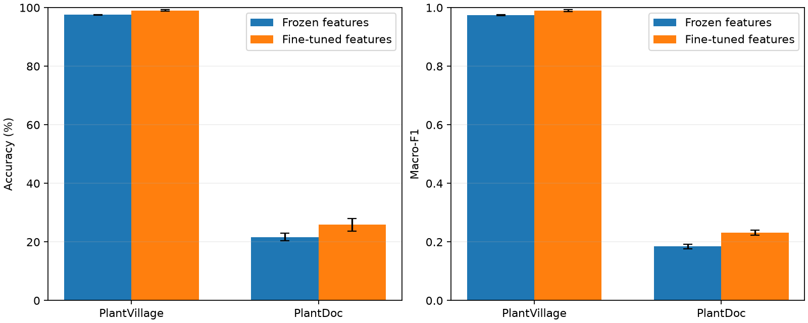
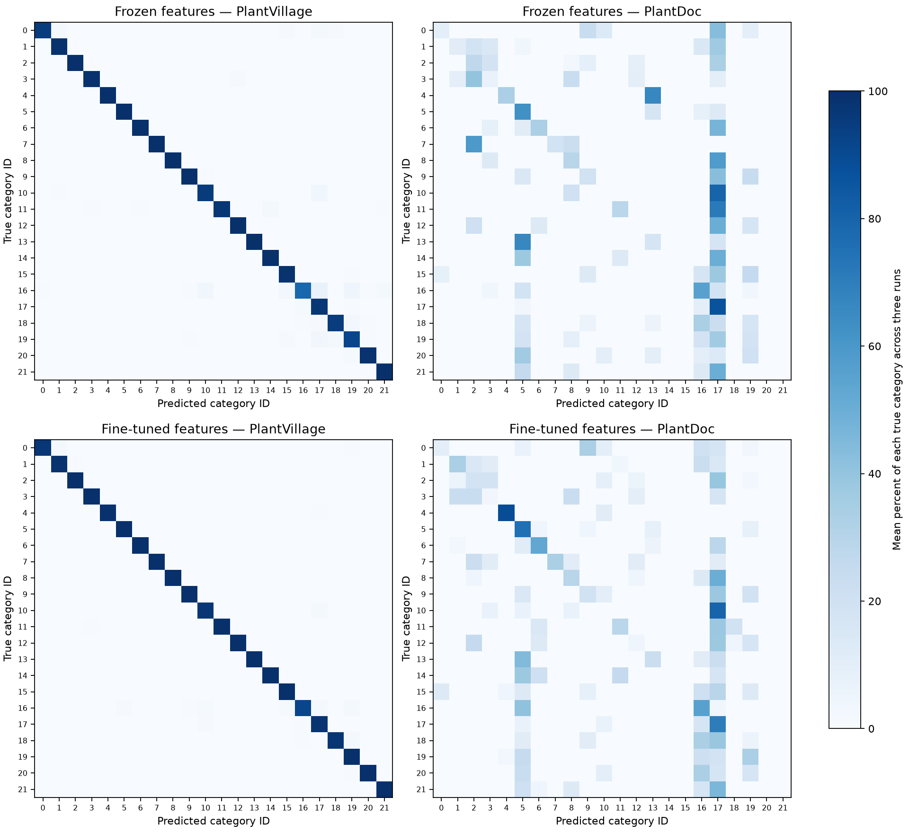

# Abstract

Photographs taken by casual plant owners can differ considerably from the images used to train a disease classifier. We investigated this problem by training an ImageNet-pretrained MobileNetV3-Small on PlantVillage and testing it on both PlantVillage and cropped PlantDoc. We compared a linear classifier using frozen image features with a version that also fine-tuned those features. Both versions used the same 22 plant-condition categories, fixed image lists, and three training seeds. Checkpoints were selected using PlantVillage validation loss before either final test set was evaluated. Mean accuracy was 97.59% for frozen features and 99.07% for fine-tuning on 5,487 PlantVillage test images, but only 21.68% and 25.87%, respectively, on 183 PlantDoc test images. Fine-tuning improved transfer modestly, while the large difference between datasets remained. These results show why high accuracy on familiar image conditions is insufficient evidence of practical robustness. They do not isolate weather or photography skill as causes, and they apply to the selected categories and images rather than all plant photographs.

# Introduction

A casual gardener may photograph a damaged leaf without controlling the background, framing, lighting, or camera angle. A photo-based classifier could help such users identify a possible plant condition and decide what to investigate next. However, a confident wrong label could also mislead them. The practical question is therefore whether a model trained on one collection still works when the photographs come from a different collection.

PlantDoc was introduced to support plant disease research beyond laboratory-style images [1]. Its internet-sourced photographs provide different visual conditions from PlantVillage, although cropped PlantDoc is not a direct sample of future users taking photographs. Work on PlantVillage bias further cautions that a model can exploit dataset-specific information instead of relying entirely on disease symptoms [2]. This makes external evaluation a necessary part of investigating the intended use.

Our research question is: **How does fine-tuning a lightweight pretrained model, compared with training only its final category layer, affect performance across PlantVillage and cropped PlantDoc?** We use a manageable model and one fixed experiment rather than develop a new architecture or application. Our contribution is a reproducible comparison with explicit category matching, checks for known image overlap, source-only checkpoint selection, and results from every planned training seed. We investigate robustness; we do not assume that photography skill and weather leave performance unchanged.

# Literature Review

## Dataset realism and bias

Singh et al. introduced PlantDoc as a resource for visual plant disease recognition using images gathered from the internet [1]. It makes evaluation under more varied backgrounds and image conditions possible, but its annotations and cropped classification form still need scrutiny. This motivates our use of PlantDoc as a separate test collection and our documentation of category exclusions rather than automatically equating similarly named folders.

Noyan's 2022 preprint examined bias in PlantVillage and showed that background information can be informative about its labels [2]. This supports caution about high scores on that dataset. It does not establish that our own model uses the same shortcut, since we did not perform an experiment that independently changes the background while preserving the leaf.

## Model choice and cross-dataset evaluation

Richter and Kim benchmarked 23 convolutional neural networks across 18 open plant disease datasets, comparing transfer-learning configurations with repeated runs [3]. Their broad comparison supports starting with an established architecture and checking variation between runs. However, training and testing within individual datasets answers a different question from training on PlantVillage and testing on PlantDoc. Their rankings are not an external-test performance guarantee for our setup, and our simplified classifier and training settings are not a replication of their benchmark.

Salman et al. investigated vision transformers with a mixture of experts and included PlantVillage-to-PlantDoc testing [4]. This directly overlaps our concern about transfer between datasets. Their image selection, preprocessing, and model differ from ours, so comparing headline accuracy values would not be a controlled comparison. Their study also means that we cannot claim to be the first project to investigate this dataset shift.

## Adaptation and the scope of this project

Wu et al. proposed unsupervised domain adaptation for plant disease recognition, using unlabeled target-domain data to help transfer from laboratory to field images [5]. Yang et al. studied cross-domain few-shot recognition, where a small labeled support set from the target domain helps classify new examples [6]. These are useful directions, but both provide the model with target-domain information during adaptation that our training procedure does not use.

The limitation addressed here is narrower: strong same-dataset performance leaves the reliability of a source-trained classifier on a different dataset unresolved. We measure that difference for a small, accessible model under a fixed source-only training protocol. This is an empirical baseline and reproducibility exercise, not a new solution to domain adaptation. Our literature review emphasizes studies from 2020 onward; the original MobileNetV3 paper is cited below only to identify the architecture.

# Methods

## Datasets and category matching

We used the PlantVillage color distribution hosted by its author [7] and the cropped PlantDoc classification repository [8]. The pinned revisions were `9e97599` for PlantVillage and `5467f60` for PlantDoc; the repository records the full revision identifiers. Our downloaded inventory contained 54,305 PlantVillage images, 2,342 PlantDoc training images, and 236 PlantDoc test images. These are counts of the specific downloaded files, not substitutes for the datasets' published headline counts.

Before training, we selected 22 shared plant-condition categories: ten healthy categories and twelve named conditions. Five uncertain category pairs were excluded: apple rust, corn rust, corn leaf blight, bell-pepper leaf spot, and tomato yellow virus. Their available labels were not sufficient to assume a specific equivalence. The remaining folder labels are still dataset annotations, not independently verified diagnoses. Table I gives the resulting image lists; Table II defines the category IDs used in the confusion plots and gives test support for each category.

| Image list | Dataset | Images | Role |
| --- | --- | ---: | --- |
| Training | PlantVillage | 18,023 | Fit model weights |
| Validation | PlantVillage | 4,529 | Select checkpoints |
| Source test | PlantVillage | 5,487 | Same-dataset final evaluation |
| Target test | PlantDoc | 183 | Cross-dataset final evaluation |

: Fixed image lists. Every list contains all 22 selected categories.

| ID | Category | Source test | Target test |
| --- | --- | ---: | ---: |
| 0 | Apple — Apple scab | 127 | 10 |
| 1 | Apple — healthy | 284 | 9 |
| 2 | Blueberry — healthy | 324 | 11 |
| 3 | Cherry (including sour) — healthy | 123 | 10 |
| 4 | Corn (maize) — Cercospora leaf spot Gray leaf spot | 107 | 3 |
| 5 | Grape — Black rot | 168 | 8 |
| 6 | Grape — healthy | 100 | 12 |
| 7 | Peach — healthy | 71 | 9 |
| 8 | Pepper, bell — healthy | 283 | 8 |
| 9 | Potato — Early blight | 164 | 7 |
| 10 | Potato — Late blight | 212 | 5 |
| 11 | Raspberry — healthy | 162 | 7 |
| 12 | Soybean — healthy | 973 | 8 |
| 13 | Squash — Powdery mildew | 378 | 6 |
| 14 | Strawberry — healthy | 80 | 8 |
| 15 | Tomato — Bacterial spot | 436 | 8 |
| 16 | Tomato — Early blight | 215 | 9 |
| 17 | Tomato — Late blight | 375 | 10 |
| 18 | Tomato — Leaf Mold | 172 | 6 |
| 19 | Tomato — Septoria leaf spot | 337 | 11 |
| 20 | Tomato — Tomato mosaic virus | 66 | 10 |
| 21 | Tomato — healthy | 330 | 8 |

: Category IDs and numbers of test images. Names summarize the PlantVillage labels; exact paired folder names are recorded in the category configuration.

## Preventing known overlap

We audited all files, including unused PlantDoc training images, for identical file bytes and available leaf identifiers. Files connected by either relationship were grouped together. Groups with conflicting labels were excluded. Existing test images were preserved, and related training members were excluded; if a group crossed the two test datasets, PlantDoc test members took priority. Training images were never moved into a test set. Within a retained partition, only one copy of each byte-identical image was kept. Different photographs of the same known leaf remained together.

Approximately 20% of each remaining source category was assigned to validation using whole groups and split seed 551. Group sizes prevent an exact percentage. This produced the fixed lists in Table I. Of 56,883 audited images, 28,661 were unused or excluded: 26,788 were outside the selected categories, 1,834 were unused target-training images, 18 belonged to conflicting-label groups, five training images were related to reserved tests, and 16 were redundant byte copies. These are exclusive bookkeeping reasons, not a count of incorrectly labeled images.

All selected files were checked for known group overlap across partitions. This reduces a common source of inflated test scores but does not prove complete independence: some leaf identifiers are missing, and byte matching does not identify every resized or re-encoded copy. PlantDoc training images did not fit model weights, select checkpoints, or calibrate model statistics. Their metadata participated only in the label and overlap audit.

## Model and image preparation

MobileNetV3 is a convolutional architecture designed for efficient image recognition [9]. We used the Torchvision MobileNetV3-Small implementation and its pinned `IMAGENET1K_V1` weights [10]. Pretraining provides image features learned before this plant experiment. We replaced the entire original classifier with one linear layer mapping 576 pooled features to 22 category scores. The resulting model has 939,702 parameters, including 12,694 in the new category layer.

In the **frozen-feature** version, only that final layer learned from PlantVillage. In the **fine-tuned** version, the first epoch also trained only that layer, after which the feature weights learned as well. Batch-normalization running statistics stayed fixed in both versions; its learned scale and offset could change in the fine-tuned version. Models within each seed pair started with matching feature and classifier weights and received the same image order for each epoch they both completed.

Each image was orientation-corrected, converted to RGB, resized with bilinear interpolation while preserving its aspect ratio, and padded to 224 by 224 pixels. Padding and any transparency used RGB (124, 116, 104), approximately the ImageNet mean color. Pixel values were scaled to 0–1 and normalized with means (0.485, 0.456, 0.406) and standard deviations (0.229, 0.224, 0.225). We used identical processing for training, validation, and testing, with no random augmentation. Padding retained the whole image instead of using the reference weights' center crop; we did not establish that padding was optimal.

## Training and checkpoint selection

Both versions used unweighted cross-entropy loss and AdamW, with batch size 32 and weight decay 0.0001. The new category layer used learning rate 0.001; unfrozen feature weights used 0.0001. The optimizer was reset after the head-only warmup epoch in both versions. There was no learning-rate schedule or hyperparameter search.

We trained three matched pairs with seeds 551, 552, and 553. These seeds changed classifier initialization and image order, not the image lists. Each run had a ten-epoch limit, including warmup, and stopped after three eligible epochs without improved source validation loss. Only checkpoints after warmup were eligible. The selected checkpoint had the lowest source validation loss, rather than necessarily the highest validation accuracy. Frozen runs selected epochs 9, 10, and 10; fine-tuned runs selected epochs 5, 4, and 3, and stopped after epochs 8, 7, and 6.

All six models were retained. We reloaded them and reproduced their recorded validation scores on all 4,529 validation images. Their fingerprints and selection record were committed before final testing. No PlantDoc score selected a checkpoint, training setting, category, or seed. The earlier two-epoch feasibility trial on a small source subset was excluded from these reported results.

## Evaluation and reproducibility

We evaluated every selected model once on the same 5,487 source-test and 183 target-test images, using evaluation mode, float32 inference, and batch size 32. No weights or running statistics changed. We report accuracy, the fraction of correct predictions, and macro-F1, which gives each category equal weight when combining precision and recall. The implementation assigns F1 zero when its denominator is zero. Class counts, per-class scores, and confusion matrices accompany the overall results.

Means and sample standard deviations summarize three training seeds on one fixed test set per dataset. They are not confidence intervals or results from independently sampled test sets. For each seed, we also subtract PlantDoc accuracy from PlantVillage accuracy, then summarize those paired gaps. Confusion plots average row-normalized matrices across seeds; they are not ensemble predictions.

The experiment ran under WSL2 with an NVIDIA GeForce RTX 4060 Laptop GPU with approximately 8 GiB of memory, Python 3.12.3, PyTorch 2.13.0+cu126, and Torchvision 0.28.0+cu126. Two loading workers and deterministic algorithms were used. Exact numerical agreement across hardware or software versions is not guaranteed.

The project repository [11] provides pinned dependencies, dataset access instructions, category mappings, split summaries, training commands, and final result records. Starting with its setup guide, the reproduction sequence is to audit the pinned files, build the fixed splits, train and verify all three pairs, record selected checkpoints, and then evaluate them. The data, training, and evaluation guides give the commands. Raw images and model weights are not bundled in Git. File fingerprints detect changed images, lists, and checkpoints. Saved predictions were independently reconciled with all reported metrics and confusion counts, and the completed code passed 39 automated tests. The code snapshot for this report is `9619975`; the pre-test selection record is in `4935bf8`.

# Results

## Performance on the two datasets

Table III and Fig. 1 summarize the final test results. Frozen features achieved 97.59% mean accuracy on PlantVillage but 21.68% on PlantDoc. Fine-tuning achieved 99.07% and 25.87%, respectively. Macro-F1 showed the same broad pattern, falling from 0.9746 to 0.1848 for frozen features and from 0.9899 to 0.2319 for fine-tuning. Thus, the large accuracy gap was accompanied by poor average category-level performance.

| Model | Test dataset | Accuracy (%) | Macro-F1 |
| --- | --- | ---: | ---: |
| Frozen | PlantVillage | 97.59 ± 0.10 | 0.9746 ± 0.0014 |
| Frozen | PlantDoc | 21.68 ± 1.26 | 0.1848 ± 0.0080 |
| Fine-tuned | PlantVillage | 99.07 ± 0.24 | 0.9899 ± 0.0028 |
| Fine-tuned | PlantDoc | 25.87 ± 2.21 | 0.2319 ± 0.0092 |

: Final test means ± sample standard deviations across three seeds. Accuracy standard deviations are percentage points. All runs reuse the same images.

Fine-tuning improved mean PlantDoc accuracy by 4.19 percentage points over frozen features. Nevertheless, the mean source-minus-target accuracy gap remained 75.92 ± 1.30 percentage points for frozen features and 73.21 ± 2.30 for fine-tuning. Table IV includes every seed rather than selecting the best run. Fine-tuning improved target accuracy in all three pairs, but three runs on the same 183 images do not establish statistical significance or general field reliability.

| Seed | Model | Source accuracy (%) | Source macro-F1 | Target accuracy (%) | Target macro-F1 |
| --- | --- | ---: | ---: | ---: | ---: |
| 551 | Frozen | 97.67 | 0.9753 | 22.40 | 0.1846 |
| 551 | Fine-tuned | 99.25 | 0.9916 | 23.50 | 0.2240 |
| 552 | Frozen | 97.48 | 0.9730 | 22.40 | 0.1929 |
| 552 | Fine-tuned | 99.16 | 0.9915 | 27.87 | 0.2419 |
| 553 | Frozen | 97.63 | 0.9756 | 20.22 | 0.1769 |
| 553 | Fine-tuned | 98.80 | 0.9866 | 26.23 | 0.2297 |

: All selected models on both final test sets. Source is PlantVillage; target is PlantDoc. Accuracy is expressed as a percentage.

## Error patterns and practical cost

Figure 2 shows the strong diagonal on PlantVillage and more dispersed errors on PlantDoc. One recurring error pattern was overprediction of tomato late blight (category 17). Only ten target images carried that annotation, but frozen models predicted it for 61, 70, and 75 of the 183 images; fine-tuned models predicted it for 59, 54, and 42 images. This identifies a confusion worth investigating, not its biological or visual cause. Per-class precision, recall, and F1 are included in the repository results.

Full-source training and validation loops took 5.8–6.1 minutes per frozen run and 3.6–5.0 minutes per fine-tuned run on the laptop GPU. Fine-tuned runs stopped earlier, so these totals are not a controlled speed comparison. They exclude startup, checkpoint writing, and subsequent verification. The runs demonstrate that this experiment was feasible on the available hardware; they do not establish mobile-device performance or production inference speed.

# Discussion

The results answer our research question with a qualified finding: fine-tuning helped this compact model transfer to the selected PlantDoc subset, but the improvement was small relative to the remaining gap. Source validation and source-test accuracy near 99% were insufficient evidence that the classifier would work reliably on a different image collection. For casual users, the practical implication is that familiar-looking demonstration accuracy should not be presented as dependable identification from everyday photographs.

This outcome is consistent with the broader concern about dataset bias [2] and the need for explicit cross-dataset evaluation [4]. However, we did not reproduce either study's exact protocol or compare all of its methods. Adaptation studies [5], [6] address a different situation by using target-domain information during model development. Their results therefore cannot be used as a direct ranking against this source-only baseline without matching datasets, categories, splits, and access to target data.

Several limitations constrain interpretation. First, cropped PlantDoc is a small internet-sourced benchmark, not a controlled collection from casual gardeners. Its selected test categories have only 3–12 images each. The three seeds repeat predictions on these same images; they do not turn 183 photographs into 549 independent test examples. Class proportions differ between datasets, and macro-F1 cannot remove uncertainty from sparse or incorrect annotations.

Second, label matching and image independence remain imperfect. Excluding five uncertain pairs makes the evaluation narrower than the original datasets. The accepted mappings were reviewed but not independently confirmed by plant specialists. Missing leaf identifiers and altered duplicates can escape the overlap checks. The protocol documents and reduces known problems rather than certifying the datasets as error-free.

Third, only one architecture, one fixed split, one preprocessing choice, and one training configuration were tested. We used no augmentation or target adaptation. The results do not establish the best achievable PlantDoc performance, and they do not prove that all fine-tuning methods improve transfer. The observed overprediction of tomato late blight deserves inspection, but model predictions alone cannot justify relabeling or deleting difficult test images.

Finally, differences in backgrounds, lighting, framing, symptom appearance, class proportions, and annotations occur together across the datasets. Our experiment does not isolate any one of them. In particular, it cannot confirm that weather or photography skill does not affect performance, nor can it attribute the accuracy drop specifically to either factor. Those causal questions require a deliberately controlled study.

# Conclusion and Future Work

We completed a reproducible comparison of frozen and fine-tuned MobileNetV3-Small models using 22 shared plant-condition categories. Fine-tuning raised mean target accuracy from 21.68% to 25.87%, while source accuracy remained much higher. The main finding is the failure of strong PlantVillage performance to carry over to the selected PlantDoc test images. Practical robustness has not been demonstrated.

Future work could test image augmentation, alternative preprocessing, better-supported category mappings, and approaches that use a limited amount of target-domain data. These would be separate experiments with a new validation and evaluation plan, not adjustments chosen to improve the already observed test scores. A larger independently checked collection of everyday plant photographs would better support claims about intended users. A controlled collection varying lighting or camera conditions would be needed to study their individual effects. Deployment as an application or diagnostic service is outside this project's completed scope.

# References

[1] D. Singh, N. Jain, P. Jain, P. Kayal, S. Kumawat, and N. Batra, “PlantDoc: A Dataset for Visual Plant Disease Detection,” in *Proc. CoDS-COMAD*, 2020, pp. 249–253, doi: [10.1145/3371158.3371196](https://doi.org/10.1145/3371158.3371196).

[2] M. A. Noyan, “Uncovering bias in the PlantVillage dataset,” *arXiv preprint arXiv:2206.04374*, 2022, doi: [10.48550/arXiv.2206.04374](https://doi.org/10.48550/arXiv.2206.04374).

[3] D. J. Richter and K. Kim, “Assessing the performance of domain-specific models for plant leaf disease classification: a comprehensive benchmark of transfer-learning on open datasets,” *Scientific Reports*, vol. 15, Art. no. 18973, 2025, doi: [10.1038/s41598-025-03235-w](https://doi.org/10.1038/s41598-025-03235-w).

[4] Z. Salman, A. Muhammad, and D. Han, “Plant disease classification in the wild using vision transformers and mixture of experts,” *Frontiers in Plant Science*, vol. 16, Art. no. 1522985, 2025, doi: [10.3389/fpls.2025.1522985](https://doi.org/10.3389/fpls.2025.1522985).

[5] X. Wu, X. Fan, P. Luo, S. Das Choudhury, T. Tjahjadi, and C. Hu, “From Laboratory to Field: Unsupervised Domain Adaptation for Plant Disease Recognition in the Wild,” *Plant Phenomics*, vol. 5, Art. no. 0038, 2023, doi: [10.34133/plantphenomics.0038](https://doi.org/10.34133/plantphenomics.0038).

[6] S. Yang, Q. Feng, J. Zhang, W. Yang, W. Zhou, and W. Yan, “From laboratory to field: cross-domain few-shot learning for crop disease identification in the field,” *Frontiers in Plant Science*, vol. 15, Art. no. 1434222, 2024, doi: [10.3389/fpls.2024.1434222](https://doi.org/10.3389/fpls.2024.1434222).

[7] S. P. Mohanty, “PlantVillage,” author-hosted dataset distribution, revision `9e97599868962bd0079b8db4b7f1efa9185fa1e7`. [Online]. Available: <https://huggingface.co/datasets/mohanty/PlantVillage>.

[8] P. Kayal et al., “PlantDoc-Dataset,” cropped classification repository, revision `5467f6012d78d1c446145d5f582da6096f852ae8`. [Online]. Available: <https://github.com/pratikkayal/PlantDoc-Dataset>.

[9] A. Howard et al., “Searching for MobileNetV3,” in *Proc. IEEE/CVF International Conference on Computer Vision*, 2019, pp. 1314–1324, doi: [10.1109/ICCV.2019.00140](https://doi.org/10.1109/ICCV.2019.00140).

[10] Torchvision contributors, “mobilenet_v3_small,” model and pretrained-weights documentation. [Online]. Available: <https://docs.pytorch.org/vision/stable/models/generated/torchvision.models.mobilenet_v3_small.html>.

[11] coolTeamName.ipynb, “CECS-551-Plant-Disease-Classification,” project code and experiment records, code revision `9619975`. [Online]. Available: <https://github.com/EnragedWaters/CECS-551-Plant-Disease-Classification>.
