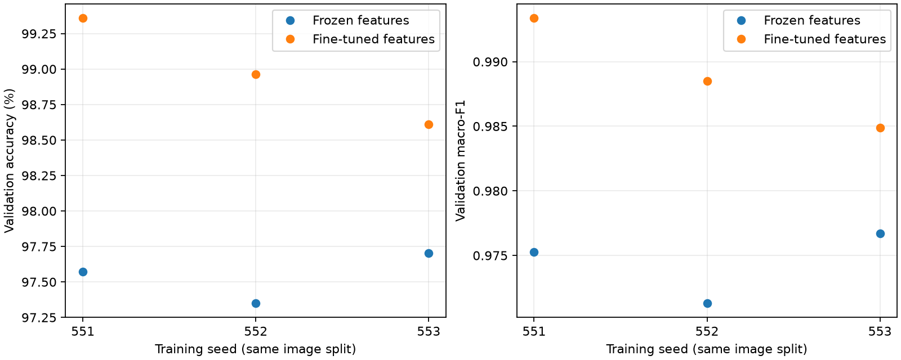

# Training repeated three times

All three planned pairs are complete. These are **PlantVillage validation
results**, not final test scores. Each pair used the same 18,023 training and
4,529 validation images across 22 categories. Only the training seed changed.
That changes the new classifier's initial weights and the training image order.

| Seed | Model | Epochs completed | Selected epoch | Validation accuracy | Macro-F1 | Loss | Loop minutes |
| --- | --- | ---: | ---: | ---: | ---: | ---: | ---: |
| 551 | Frozen features | 10 | 9 | 97.57% | 0.9753 | 0.0866 | 6.1 |
| 551 | Fine-tuned features | 8 | 5 | 99.36% | 0.9934 | 0.0230 | 5.0 |
| 552 | Frozen features | 10 | 10 | 97.35% | 0.9713 | 0.0868 | 5.8 |
| 552 | Fine-tuned features | 7 | 4 | 98.96% | 0.9885 | 0.0337 | 4.1 |
| 553 | Frozen features | 10 | 10 | 97.70% | 0.9767 | 0.0838 | 5.8 |
| 553 | Fine-tuned features | 6 | 3 | 98.61% | 0.9849 | 0.0416 | 3.6 |

The selected epoch had the lowest validation loss after warmup. The table uses
that epoch's accuracy and macro-F1, even if another epoch scored higher on those
metrics. Early stopping and the ten-epoch limit are the same for all runs.
Loop time excludes setup, saving checkpoints, and the later verification pass.

| Model | Mean validation accuracy ± sample standard deviation | Mean macro-F1 ± sample standard deviation |
| --- | --- | --- |
| Frozen features | 97.54% ± 0.18 percentage points | 0.9744 ± 0.0028 |
| Fine-tuned features | 98.98% ± 0.38 percentage points | 0.9889 ± 0.0043 |

The ± values describe variation across three training seeds. They are not
confidence intervals, uncertainty from different image splits, or evidence of
statistical significance. All runs share one validation set, and that set was
used to select their checkpoints. We report all seeds, not a winning seed.

Each point is a separate run; a larger seed number has no directional meaning.
The plot axes are zoomed to show small differences; the full metric ranges are
0–100% accuracy and 0–1 macro-F1. Strong validation scores do not establish
performance on PlantDoc, casual photographs, or new weather conditions.

Every saved model was reloaded and reproduced its scores on all validation
images. Frozen feature weights stayed fixed; fine-tuned feature weights changed;
batch-normalization running statistics stayed fixed in both versions. Training
settings, source image lists, preprocessing, and core training code match across
all three seeds. Both models had matching warmup results within each pair.

The [selected-checkpoint record](selected-checkpoints.json) identifies all six
models by their file fingerprints before final test evaluation. The next step
is to evaluate **all six** on the same reserved PlantVillage and PlantDoc test
lists, without changing settings or choosing seeds based on test results.
Neither final test set was evaluated during these training repetitions.

See [all recorded measurements](repeated-training.json), the individual reports
for [551](source-seed-551.md), [552](source-seed-552.md), and
[553](source-seed-553.md), and [run instructions](../training.md).
