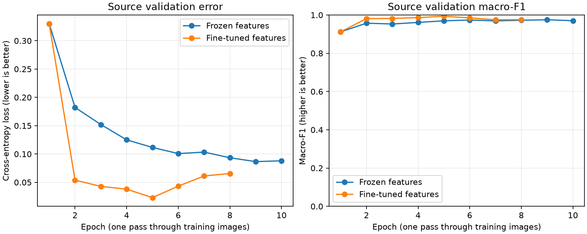

# First full-source training comparison

These are **validation results**, not final test results. Both models trained on
18,023 PlantVillage images and were checked against the same
4,529 separate PlantVillage validation images. No PlantDoc
images were used in this training comparison.

| Model | Epochs completed | Selected epoch | Validation accuracy | Macro-F1 | Validation loss | Loop minutes | Peak allocated GPU MiB |
| --- | ---: | ---: | ---: | ---: | ---: | ---: | ---: |
| Frozen features | 10 | 9 | 97.57% | 0.9753 | 0.0866 | 6.1 | 148 |
| Fine-tuned features | 8 | 5 | 99.36% | 0.9934 | 0.0230 | 5.0 | 579 |

Accuracy is the fraction classified correctly. Macro-F1 gives each category
equal weight when combining precision and recall. The checkpoint was selected
using the lowest validation loss after warmup, not the highest accuracy or F1.
All three metrics in each row come from that same selected epoch.

The initial budget was 10 epochs, including
1 head-only warmup epoch, batch size 32,
and random seed 551. Early stopping waits for 3
post-warmup epochs without lower validation loss. The category layer learning
rate is 0.001 and the unfrozen feature learning rate is
0.0001. Both use identical image lists and starting weights.

Loop times include training and validation, but exclude setup, checkpoint writing,
and reporting. GPU memory is PyTorch's allocated memory, excluding CUDA context
and other applications. Different stopping points mean different total work.

This is one pair of runs. It does not measure variation across random seeds,
prove robustness, or establish performance on PlantDoc. Validation influenced
checkpoint selection, so these scores cannot substitute for held-out test scores.
Keep test sets reserved until the experiment settings are fixed.

See [the machine-readable record](source-seed-551.json) for all epoch metrics, settings,
software versions, and fingerprints. See [the training guide](../training.md)
for reproduction instructions. Model weights remain in ignored local outputs.
